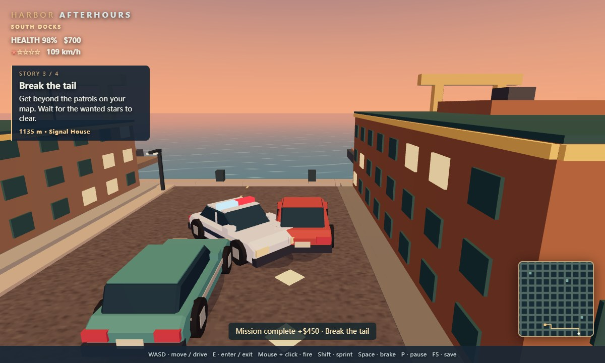

# Harbor Afterhours

[在线使用 / Open in browser](https://xialin99.github.io/makefun-harbor-afterhours/)

[中文](#中文) · [English](#english)

## 中文

原创港城动作游戏，包含步行、驾驶、交通、追逐、任务和本地存档。

### 本地运行

在项目根目录执行 `python -m http.server 8080 --directory game`，再用桌面浏览器打开 `http://localhost:8080`。支持 WebGL 渲染与俯视回退。

## English

An original harbor-city action game with on-foot travel, driving, traffic, chases, missions, and local saves.

### Run locally

Run `python -m http.server 8080 --directory game` from the repository root and open `http://localhost:8080` in a desktop browser. The game includes a top-down fallback when WebGL is unavailable.

[补充技术说明 / Additional technical notes](README.details.md)

[make.fun 赛事 / Original bounty](https://make.fun/bounty/gta6-01)

## 许可证 / License

MIT. See [LICENSE](LICENSE).

赛事模板组件的授权见 [LICENSE-makefun.txt](LICENSE-makefun.txt)。

Kit components are covered by [LICENSE-makefun.txt](LICENSE-makefun.txt).

Three.js 保留其 [MIT 版权声明](game/vendor/LICENSE)。

Three.js retains its [MIT license notice](game/vendor/LICENSE).

